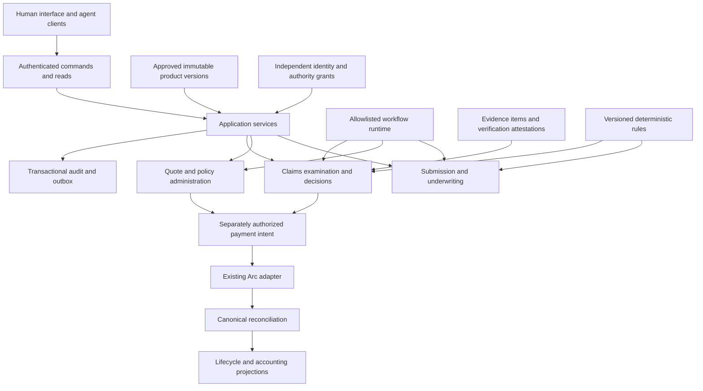

# Arcuex architecture audit and incremental migration

Date: 2026-11-18. Baseline: `f8365a85f0c4a6298f713be7e799cb7538ca1fc7`. Everything described as target, proposed or planned is future work. Read [scope and evidence](README.md) before interpreting maturity claims.

## A. Existing architecture map

Paths below are relative to this worktree. Source presence establishes implementation scope, not enterprise readiness or a new test pass.

| Area and source evidence                                                                                                                                                                                                                                                                                           | Reusable implementation                                                                                                                                            | Coupling or missing capability                                                                                                                                                                                                                       | Migration treatment                                                                                                                                                                                                                      |
| ------------------------------------------------------------------------------------------------------------------------------------------------------------------------------------------------------------------------------------------------------------------------------------------------------------------ | ------------------------------------------------------------------------------------------------------------------------------------------------------------------ | ---------------------------------------------------------------------------------------------------------------------------------------------------------------------------------------------------------------------------------------------------- | ---------------------------------------------------------------------------------------------------------------------------------------------------------------------------------------------------------------------------------------- |
| [`domain/entities.ts`](../../../packages/domain/src/entities.ts), [`terms.ts`](../../../packages/domain/src/terms.ts), [`transitions.ts`](../../../packages/domain/src/transitions.ts)                                                                                                                             | Zod entities, immutable terms snapshots, quote/policy/incident/claim transitions                                                                                   | `CoverageProduct` is metadata with an `active` boolean; no governed product publication. Terms have product version but no workflow/evidence/ruleset pin. Monetary types are USDC micros.                                                            | Retain legacy contracts. Add a distinct product-definition contract; do not rename entities or add required fields to old payloads.                                                                                                      |
| [`domain/procurement.ts`](../../../packages/domain/src/procurement.ts), [`agent-sdk/procurement.ts`](../../../packages/agent-sdk/src/procurement.ts)                                                                                                                                                               | Owner/signer separation, expiring quotes, digest acceptance, scoped delegation, cumulative premium caps, request fingerprints                                      | A second policy/quote model. Fixed oracle event/protocol, Arc chain, positive USDC micros, limit/duration menus, premium `limit/100`, deductible `limit/10`, quote TTL 600s and start delay 900s. Server orchestration lives in a package named SDK. | Preserve V1 wire payloads, serializer and hashes. Initially describe this behavior with a definition and fixture; later redirect only new flows to a reviewed resolver.                                                                  |
| [`insurance/quote-to-bind.ts`](../../../packages/insurance/src/quote-to-bind.ts), [`domain/synthetic-product.ts`](../../../packages/domain/src/synthetic-product.ts)                                                                                                                                               | Original SQLite synthetic quote/bind flow, audit and idempotency hooks                                                                                             | `ARCUE_X_SYNTHETIC_V1` differs from `ARC_ORACLE_LIQUIDATION_DEMO_V1`. Funding is a service input, not live payment proof; legacy flow activates synthetic records directly.                                                                          | Keep it a separate synthetic ledger capability. Never treat a legacy active row as an Arc bind or merge product codes silently.                                                                                                          |
| [`insurance/claims-case.ts`](../../../packages/insurance/src/claims-case.ts), [`claims-case-service.ts`](../../../packages/insurance/src/claims-case-service.ts)                                                                                                                                                   | Case state machine, role checks, REVIEW with no payable authorization, optimistic row versions, frozen decision/evidence/recipient binding, settlement preparation | No configurable nine-checkpoint dossier, full policy-trigger/notice taxonomy, distinct legal liability determination, general partial decision or appeal process. DENIED and PAID are terminal in V1.                                                | Add versioned determinations and compatibility mappings. Preserve V1 transitions and do not insert arbitrary new states into existing rows.                                                                                              |
| [`domain/interfaces.ts`](../../../packages/domain/src/interfaces.ts), [`insurance/synthetic-oracle-wedge.ts`](../../../packages/insurance/src/synthetic-oracle-wedge.ts)                                                                                                                                           | EvidenceProvider, IncidentVerifier and CoverageRule seams; explicit synthetic fixture verification                                                                 | Typed interfaces still use existing policy/facts/USDC shapes. Fixture output is not authenticated external evidence; rule output can include quantum.                                                                                                | Reuse seams through concrete product adapters. Separate observed facts, verification, coverage and quantum records without removing the existing interfaces.                                                                             |
| [`claims-case-service.ts`](../../../packages/insurance/src/claims-case-service.ts), [`persistence/claims-case-persistence.ts`](../../../packages/persistence/src/claims-case-persistence.ts)                                                                                                                       | Evidence manifests, content digests, source/provenance metadata, frozen root at adjudication                                                                       | Completeness is a supplied boolean plus manifest presence, not product requirements. A non-claimant `verificationMethod` label can affect authenticity; no general verifier attestation/object retention/access lifecycle.                           | Treat current metadata as a trust boundary to strengthen, not a finished evidence registry. Do not promote labels or AI summaries into verified observations.                                                                            |
| [`insurance/net-loss.ts`](../../../packages/insurance/src/net-loss.ts), [`canonical-loss-key.ts`](../../../packages/insurance/src/canonical-loss-key.ts), [`domain/capital.ts`](../../../packages/domain/src/capital.ts)                                                                                           | Explicit unknown recoveries → REVIEW; deduction/cap logic, committed loss checks, conservation and solvency helpers                                                | Indemnity-oriented USDC amounts. Claims loss key contains chain/policy identity and must not be advertised as a global cross-policy duplicate detector. Synthetic accounting and pool accounting are distinct.                                       | Retain formula/identities for the current product. Add a separate occurrence/correlation identity and product-selected quantum methods later; never rehash existing loss keys.                                                           |
| [`onchain/tx.ts`](../../../packages/onchain/src/tx.ts), [`ids.ts`](../../../packages/onchain/src/ids.ts), [`InsurancePool.sol`](../../../contracts/src/InsurancePool.sol)                                                                                                                                          | Explicit approval/bind/settlement preparations, receipt/event checks, reservation and claim/loss caps                                                              | Arc USDC, EVM wallets and a designated claims authority. `bindPolicy` does not interpret product wording or enforce backend quote/delegation approval. `settleClaim` requires payment within the on-chain coverage window.                           | Keep deployed contract and ABI unchanged. The adapter must reject unsupported product semantics, including claims-payment schedules incompatible with contract expiry. No generic product can bypass these limits through configuration. |
| [`policy-reconciliation.ts`](../../../apps/web/src/lib/server/policy-reconciliation.ts), [`policy-read-api.ts`](../../../apps/web/src/lib/server/policy-read-api.ts), [`reconciliation-worker.cjs`](../../../deploy/railway/reconciliation-worker.cjs), [`supervisor.cjs`](../../../deploy/railway/supervisor.cjs) | Canonical event indexing, immutable-record linkage, unlinked/incomplete/orphaned states, 300s freshness, supervised operational worker                             | Read contract and scope are Arc-specific. Older documentation omits the worker added in this baseline. Historical pending rows can appear on another policy's detail page.                                                                           | Reuse provenance/freshness policy. Separate per-policy and portfolio warnings; do not conflate one old unlinked row with failure of a new verified policy.                                                                               |
| [`claims-session.ts`](../../../apps/web/src/lib/server/claims-session.ts), [`claims-auth.ts`](../../../packages/insurance/src/claims-auth.ts), [`request-boundary.ts`](../../../apps/web/src/lib/server/request-boundary.ts)                                                                                       | Signed-wallet sessions, server-assigned roles, origin/rate boundaries, private acceptance gate                                                                     | Wallet-centered subjects, shared role classes, no general organization/tenant model or insurer authority matrix. Procurement delegation is backend-only; revocation cannot invalidate already-prepared calldata.                                     | Preserve beta auth. Introduce scoped authority independently of product config; require tenant isolation before multi-organization write APIs.                                                                                           |
| [`persistence/procurement.ts`](../../../packages/persistence/src/procurement.ts), [`repository.ts`](../../../packages/persistence/src/repository.ts), [`migrations`](../../../packages/persistence/src/migrations)                                                                                                 | SQLite transactions, immutable procurement records, optimistic claims updates, audit rows, reconciliation tables                                                   | No approved-product registry, durable configurable workflow runs, general outbox or tenant-scoped uniqueness. Two sets of policy tables coexist intentionally.                                                                                       | Additive tables only after contract approval. Test upgrades against copies; preserve every original row, ID, digest, receipt and foreign-key relationship.                                                                               |
| [`procurement-http.ts`](../../../packages/agent-sdk/src/procurement-http.ts), [`human-procurement-panel.tsx`](../../../apps/web/src/components/coverage/human-procurement-panel.tsx), [`policies-panel.tsx`](../../../apps/web/src/components/coverage/policies-panel.tsx)                                         | Human/agent procurement paths and owner-filtered lifecycle views                                                                                                   | UI/HTTP clients contain product-specific forms and behavior; SDK combines server-side orchestration and clients. There is no general product discovery/questionnaire negotiation.                                                                    | Add versioned read and dry-run interfaces before changing existing clients; keep authoritative authorization on the server.                                                                                                              |

Current maturity is therefore a functional synthetic Arc product with reusable safeguards and several narrow subsystems. Product Studio, general underwriting, enterprise identity, generalized workflows, AI examination and rail-independent operation are not implemented platform capabilities.

Existing tests worth preserving include `procurement.test.ts`, `claims-case-service.test.ts`, `net-loss.test.ts`, `procurement-claims.test.ts`, `policy-reconciliation.test.ts`, `policy-read-api.test.ts`, `tx.test.ts`, loss-key/capital tests, reconciliation worker tests and the Foundry contract suite. These were inspected as test definitions, not rerun in this planning assignment.

## B. Target modular architecture

### Package and deployment approach

Use the current monorepo and one application/database for the first implementation. Put pure product, evidence-requirement and workflow-definition contracts in `packages/domain`; pure evaluation and application orchestration in `packages/insurance`; repositories and transactional event/outbox storage in `packages/persistence`; the existing financial implementation in `packages/onchain`; HTTP/auth/UI in `apps/web`; and typed remote clients in `packages/agent-sdk`.

These are bounded modules, not a proposal for thirteen microservices. Do not build a workflow editor, message broker, second rail, model-provider adapter or generic plugin loader before a concrete task needs one. The first non-Arc specimen is a local validation fixture, not a usable insurance product or an unused production adapter.

Every arrow crossing a service boundary carries an authenticated context, correlation/idempotency ID and pinned version references. UI/SDK calls never directly mark a policy bound or payment paid. The runtime schedules capability commands; their owners enforce authorization again at execution.

### Authoritative records and owners

| Record/module                                   | Owns                                                                                                                                                                      | Must not infer or authorize                                                                                                                               |
| ----------------------------------------------- | ------------------------------------------------------------------------------------------------------------------------------------------------------------------------- | --------------------------------------------------------------------------------------------------------------------------------------------------------- |
| ProductDefinitionVersion / Registry             | Coverage design, wording references, questionnaires, trigger/notice definitions, approved rule/workflow/evidence references, supported settlement capability requirements | A draft, product creator or configuration field cannot grant underwriting, binding, claims or payment rights.                                             |
| ProductPublication / ApprovalAttestation        | Review/approval/retirement events for a content hash, reviewer identity and the authority grant used                                                                      | Retirement prevents new offers under policy; it does not invalidate bound policies or remove wording/evidence history.                                    |
| RiskSubmission / SubmissionRevision             | Applicant, insured entities/systems, answers, requested coverage, documents and attestations at a point in time                                                           | A wallet signature alone is not proof of an enterprise's legal identity, position ownership or authority to disclose documents.                           |
| UnderwritingDecision                            | Rule version, exact input revision, observations, missing information, referral reasons, authorized quote permission and validity                                         | Dry-run output and an AI recommendation cannot issue a quote or certify insurability.                                                                     |
| Quote / Acceptance / IssuanceRecord             | Exact terms, premium/asset, subjectivities, expiry, parties, issuer/bind authority and accepted digest; issuance proof plus applicable wording/schedule                   | A capital pool is not inherently the insurer. A chain receipt is financial evidence, not necessarily legal issuance confirmation.                         |
| PolicySnapshot / PolicyChange                   | Immutable issued terms and pinned product/workflow/rules/evidence versions; separately authorized effective amendments                                                    | Updating catalog versions must not change past coverage. Endorsements append superseding schedules and affected periods; no rewrite of original terms.    |
| WorkflowDefinition / WorkflowRun                | Validated typed steps, dependencies, wait/referral points, bounded retries, timeouts, events and input/output references                                                  | No eval, arbitrary JavaScript, SQL, URL-driven capabilities or user-defined code. Config chooses only deployed allowlisted operations.                    |
| EvidenceItem / VerificationAttestation          | Source identity, collection/observation times, content digest, provenance, custody, verification result, confidentiality/access/retention policy                          | Digest proves content identity, not truth. Collection, assertion, verified observation and AI inference remain separate.                                  |
| ClaimsCase / ClaimDetermination                 | Product-specific intake, checkpoint assessments, requested information, recommendations, authorized outcomes and heads of loss                                            | Case routing, confidence or technical verification alone cannot establish coverage, legal liability or payable loss.                                      |
| AuthorityGrant / AuthorityDecision              | Grantor, subject, organization/tenant, action, product/version, time, limits, aggregate budget and required co-approvals/revocation                                       | A product's requested authority is not a grant. Grants must be rooted in independently approved organization arrangements, not self-asserted role labels. |
| PaymentIntent / Reservation / SettlementReceipt | Exact asset, amount, beneficiary, policy, loss identity, adjudication/evidence binding, authorizations and rail capability                                                | Payment preparation, submission, finality and accounting reconciliation are different states; AI cannot collapse them.                                    |
| Audit / LifecycleProjection                     | Actor and reason provenance plus immutable inputs, source versions, receipts, status freshness and rebuildable reads                                                      | A historical verified event is not indefinitely fresh proof; do not present global warnings as a specific policy's state.                                 |

### Product definition contract

The proposed `InsuranceProductDefinitionV1` is not a replacement for `CoverageProduct`, `CoverageTerms` or `ProcurementTerms`. It has a schema version, stable product identity, immutable definition version, synthetic marker, provider/risk-bearing role references, wording and clause references, insured-exposure schema, selectable insuring agreements, trigger/notice conditions, coverage/sublimit/deductible terms, underwriting questionnaire/rating references, evidence requirements, workflow/ruleset references, approved routing-policy reference and supported payment-capability requirements.

Use structured discriminated definitions for occurrence, claims-made-and-reported, discovery/reporting and circumstance notice. Record event, discovery, demand and reporting dates separately, with timezone/precision and retroactive/extended-reporting conditions when applicable. Distinguish a contractual trigger from the evidence verifier used to establish its facts. Missing material dates or facts produce `needs_information` or referral, not an invented date or automatic denial.

Pricing methods are versioned deployed identifiers with validated parameters and explicit synthetic/rating-approval status. Do not accept executable expressions or present demo `limit/100` as actuarial pricing. Define indemnity and parametric benefit methods separately; the latter is not automatically subject to a universal indemnity net-loss formula. Both still require authenticated trigger/benefit evidence, product-specific compensation/aggregation rules and independent payment authority.

Avoid currency ambiguity: a proposed amount contract uses integer base units plus a pinned asset reference and scale. Currency, token, coverage denomination, premium asset and settlement asset are explicit. No floating point, implicit FX or currency mixing. Existing `UsdcMicros` remains unchanged; the Arc adapter accepts only its concrete supported asset/semantics. Unsupported fiat/nonfinancial examples validate definitions only; they cannot be bound on the current rail.

Separate canonical content from mutable publication metadata. Draft revisions can change; publication approvals bind an immutable content hash. Consumers reject unsupported schema versions and dangling/unapproved references. A product bundle pins its workflow, rules, wording and evidence versions before an offer can be authorized. New definition hashing is explicitly versioned and domain-separated; it must never replace the existing V1 terms hashing or ID algorithms. Retain the original approved bytes/canonical representation for audit.

### Trust and authority model

1. End users, documents, agents, model outputs, webhooks and product editors supply untrusted input. Authenticate source, tenant and actor independently before use.
2. Product authors can draft; authorized reviewers approve publication; independently granted underwriters/issuers authorize quote and bind; examiners assess; settlement approvers authorize intents; rail signers execute. An insurer may grant bounded automation, but configuring a workflow does not create that grant.
3. Evaluate delegated scope at execution, not only preparation: subject, tenant, product/version, action, expiry, beneficiary restrictions, per-case and cumulative limits, revocation and required separation of duties. Budget reservation and concurrency checks are transactional.
4. Existing Arc EOAs can execute already-prepared transactions outside the backend. Backend-only revocation and product rules cannot be represented as cryptographically enforced financial controls. Stronger signer/custody arrangements require a separately approved project; contracts remain unchanged in this migration.
5. Evidence source authentication, coverage analysis, causation, liability, quantum, adjudication approval and payment authority have distinct records and actors. Advisory output is linked to evidence but never promoted into the evidence itself.
6. External I/O follows committed application state with an outbox/idempotency boundary; receipt reconciliation confirms outcomes. Reorg, outage, timeout or contradictory sources suspend the affected capability and expose the reason. Do not retry an unknown payment outcome as a new payment.
7. Organization/tenant scope is established before enterprise write APIs. Enforce it in repositories, audit, object access, idempotency keys, workflow runs and capabilities, not only in the UI. Preserve the beta's explicitly single-tenant domain while this is introduced.

### Workflow and tier decisions

The first runtime is a bounded capability graph, not a universal BPMN implementation. Allowed step kinds are collect required input, validate schema, execute deterministic deployed rules, request information, refer, wait for an authorized actor, prepare a command and wait for verified receipt. Validate references, terminal outcomes, unreachable nodes, bounded repeat/wait semantics and capability compatibility before publication. Runs pin definitions and have optimistic revisions, deadlines and append-only events. Default configuration has no money-moving capability.

Tiers select handling, not payment entitlement. A routing result includes tier, matched rule IDs, reasons, required specialist/authority, missing facts and a pinned policy version. Evidence uncertainty, conflicting coverage, fraud indicators, common-cause accumulation, vulnerability/accommodation needs, legal/regulatory significance and missing authority can override amount thresholds. Missing routing facts escalate; amount-only rules cannot suppress a mandatory escalation. Tests include a tiny disputed loss and a larger clean parametric candidate. Neither automatically authorizes payment.

Tier 1 executes only approved deterministic decision rules within a separately enforceable grant. Tier 2 produces evidence-linked recommendations, collection plans and requests for information; initial implementation is read-only and introduces no model provider. Tier 3 supports specialist/human investigation, recorded reasoning, authority checking and referral. Sensitive claimant circumstances must be handled under approved data-use and access rules; no invented universal vulnerability score.

## Alignment with the approach document

Source: `Autonomous_AI_Insurance_Quote_Bind_and_Claims_Approach.docx`, sections 3, 5, 6.1, 7.1, 8, 8.1, 9 and 10. Its scope is a proposed enterprise autonomous-AI placement/claims process, not an approved universal insurer workflow. Its documented/adapted/proposed labels must travel with imported templates and requirements.

Placement must distinguish submission, completeness/appetite, introductory review, questionnaire, follow-up, underwriting report, authorized quote, acceptance/subjectivity clearance and authorized bind/issue. Product configuration can make specialist steps conditional; it cannot skip issuer authority or required conditions. Questionnaires A–G and FNOL fields CL1–CL22 are a candidate enterprise-AI template, not mandatory fields for a parametric, property or non-AI product.

The source's **actual nine adjudication checkpoints** map as follows. Evidence authenticity and duplicate prevention are cross-cutting controls, not substitutes for its separate classification and liability steps.

| Source checkpoint                | Proposed record/check                                                                                            | Current gap / reusable control                                                                                                                    |
| -------------------------------- | ---------------------------------------------------------------------------------------------------------------- | ------------------------------------------------------------------------------------------------------------------------------------------------- |
| 1. Trigger and notice            | TriggerAssessment with event, discovery, demand, report, retroactive/extended-period facts and clause references | Current intake checks an observed event against the policy window; general notice taxonomy is missing.                                            |
| 2. Insured and scope             | InsuredScopeAssessment against issued entities/assets/activities/territories                                     | Current ownership and registered exposure checks are useful but wallet ≠ insured enterprise scope.                                                |
| 3. Claim / event classification  | EventClassification and applicable insuring agreement(s)                                                         | Add explicit third-party demand, first-party loss, accident, regulatory proceeding and operational issue distinctions.                            |
| 4. Causation and technical facts | CausationAssessment with chronology and evidence references                                                      | Reuse verifier interfaces; current synthetic causal replay is one rule, not a universal causation opinion.                                        |
| 5. Liability                     | LiabilityAssessment or policy-justified not-applicable result and required specialist authority                  | No general liability decision contract. Technical failure does not prove liability.                                                               |
| 6. Coverage and exclusions       | Clause-linked CoverageDetermination per agreement/head of loss                                                   | Reuse existing determination; add conditions, consent, sublimits and mixed coverage outcomes.                                                     |
| 7. Loss quantum                  | Product-selected QuantumAssessment, prior compensation/recoveries/expenses/aggregate treatment                   | Reuse tested indemnity math without imposing it on all parametric benefits; distinguish verified and unknown amounts.                             |
| 8. Resolution authority          | Independent AuthorityDecision and approved resolution/defence/payment intent                                     | Reuse role and frozen settlement binding. Add bounded grants, co-approval and execution-time revalidation.                                        |
| 9. Closure and learning          | Decision communication, complaint/appeal/recovery/subrogation records and controlled underwriting feedback       | V1 terminal states do not implement this operating lifecycle. Feedback cannot silently amend policy wording or train a model on private evidence. |

Record `satisfied`, `not_satisfied`, `needs_information`, `referred` or justified `not_applicable` for relevant checkpoints. Outcomes include full/partial acceptance, decline, pending information, specialist referral and defence/investigation under reservation only when wording and authority permit. Source-specific Canadian notice conditions must not become platform defaults. Evidence minimization, privilege, legal hold and confidentiality apply to both underwriting and claims; do not request hidden model chain-of-thought.

## C. Incremental migration plan

| Phase                                     | Changes                                                                                                                                                                                                 | Compatibility proof / exit gate                                                                                                                                                                |
| ----------------------------------------- | ------------------------------------------------------------------------------------------------------------------------------------------------------------------------------------------------------- | ---------------------------------------------------------------------------------------------------------------------------------------------------------------------------------------------- |
| 0. Preserve November 20 baseline          | Planning branch only. Record current schema/API/hash/ID/receipt boundaries and existing test coverage. Continue release work independently.                                                             | No release code, contract, deployment or production writes in this assignment. One verified bind is evidence of the narrow journey, not all claims capabilities.                               |
| 1. Add contracts and fixtures             | A1/A3/A2, then A4/A6. Add pure schemas, publication transition contracts and current product fixture, without runtime imports from the old flow.                                                        | Negative validation tests, immutable-content semantics, non-Arc descriptive fixture, no production paths changed. Oracle fixture preserves event/exclusions/menus/timing/pricing exactly.      |
| 2. Shadow underwriting and routing        | B1/B2/B3/B6 and D2/D3 operate on local/in-memory inputs. Add explanatory traces with no issuance/settlement capability.                                                                                 | Legacy behavior and new dry-run evaluations compared for representative fixtures, including refer/decline/unknown; no output mistaken for authorized quote or payout.                          |
| 3. Govern registry and scoped access      | E1/E2 establish organization/authority boundaries; persist approved bundles append-only under A2 follow-up. Add A5 pins with B3 and E4.                                                                 | Copy-database migration tests and tenant-negative tests. Publication cannot grant execution authority; no live enterprise access before isolation evidence.                                    |
| 4. Integrate only new offers              | Route explicitly selected new quotes through approved product bundles. Append version-reference sidecars for new policies, keep V1 serializers and payloads intact; validate backend-prepared calldata. | New policy pins are exact; old issued snapshots/digests and `arcuex:policy:<uuid>` ID mapping remain byte-identical. Missing historical pins are `legacy_unpinned`, not fabricated approvals.  |
| 5. Generalize evidence and case operation | D1–D6 and E3/E5 incrementally attach immutable checkpoint records, routing and recommendations to existing ClaimsCase.                                                                                  | Old cases retain semantics. Existing REVIEW/settlement/no-double-payment invariants still pass. Appeals/partial determinations use versioned paths, not unauthorized terminal-state reopening. |
| 6. Broaden administration and interfaces  | C1–C5 and F1/F3/F4; runtime B4 consumes concrete approved operations. Arc remains the only executed adapter.                                                                                            | Endorsements append history. Human/agent semantics agree. Unsupported currency, late-payment product or rail capability is rejected; no pretend fiat settlement.                               |
| 7. Controlled rollout                     | F2/F5 gates local/isolated staging then separately approved deployment. AI remains advisory.                                                                                                            | Copy restore and deterministic replay, rollback without destroying evidence, operational freshness/reorg tests, approved carrier/jurisdiction/authority/wording for any real insurance launch. |

Historical policies must retain their original terms and receipts. A sidecar can record an audited mapping to the legacy product definition without claiming it was approved at historical issuance. New product versions do not alter claims requirements, deductibles, beneficiary or scheduled coverage for old policies. Retirement preserves retrieval. Rollback disables new-path creation and keeps readers for all stored versions; it must not delete new records or downgrade issued contracts.

## E. Smallest useful first implementation slice

Add only pure, versioned contracts and fixtures to `packages/domain`, with in-memory tests. `InsuranceProductDefinitionV1` identifies the product and pins definitions; A3 provides explicit exposure, trigger/notice, clause and evidence-requirement shapes; A6 encodes the current oracle product without changing existing imports. A2 independently supplies publication transitions and immutable revision semantics. There is no persistence migration, UI editor, live registry, new payment adapter or real product publication in this slice.

A concrete example must parse and explain the oracle product, while a descriptive nonfinancial/non-Arc example proves the schema does not require lending positions, wallets or USDC. Reject unknown capabilities and references. A fixture-based compatibility comparison must preserve existing `PROCUREMENT_PRODUCT` text and V1 quote digest for fixed inputs. This directly tests the architectural claim that configuration can describe the current product without rewriting it.

The next safe slice is dry-run underwriting (B2) and tier routing (D3), using only registered deterministic functions. Do not issue a generic workflow-runtime stub to make the architecture look complete. Runtime persistence, payment intents and tenant-ready APIs come only when their dependent tasks have concrete consumers.

Release protection remains explicit: no financial contract changes, broadcasts, production-data changes, gate changes, model-provider integrations or new external services. November 18–20 release verification and any separately authorized synthetic claims demonstration proceed on their own branch. This architecture track ends with review of this plan.
